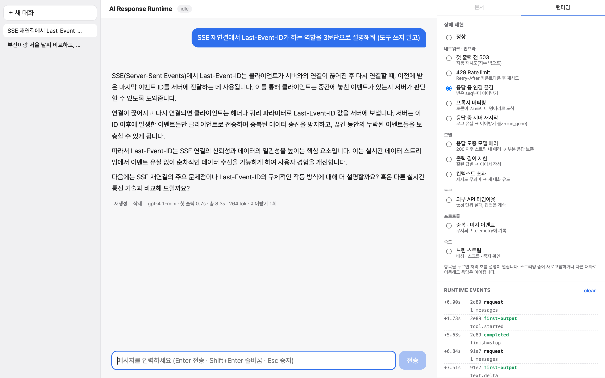
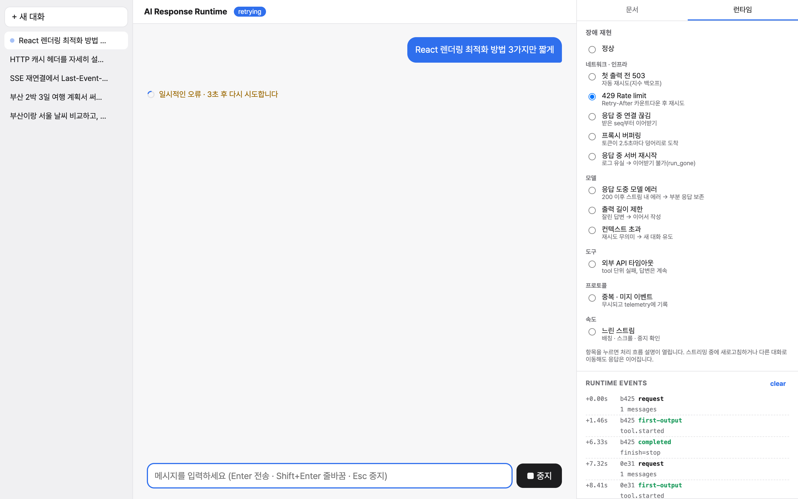
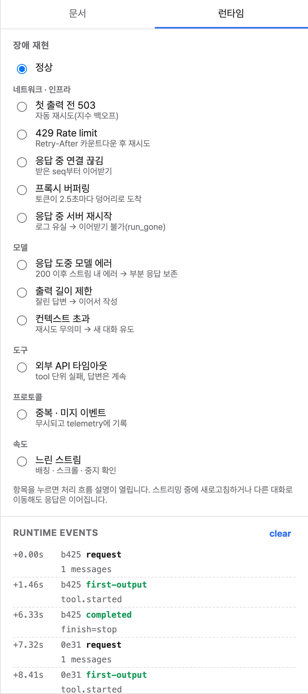
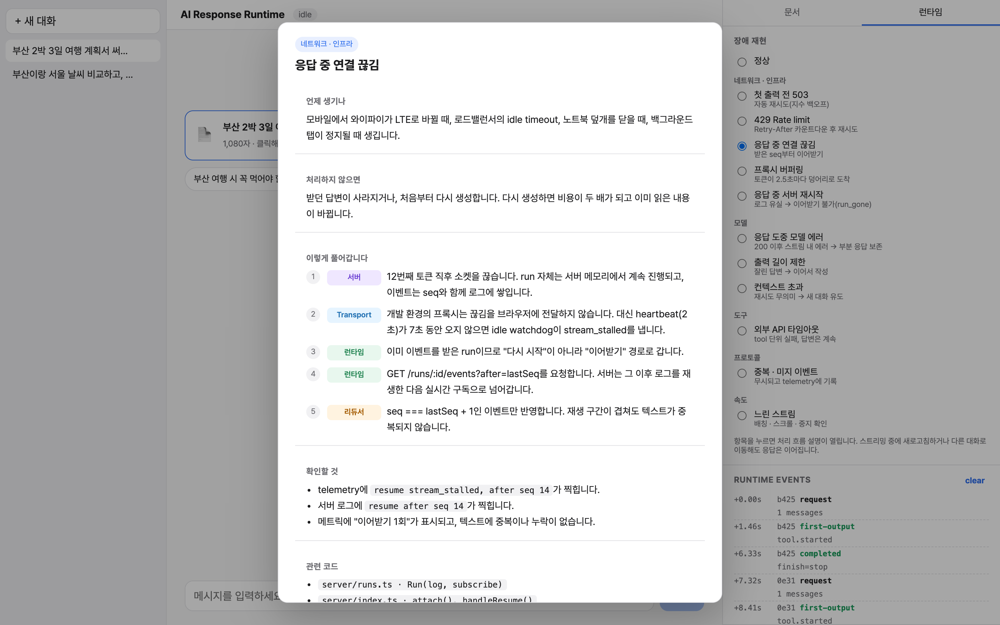
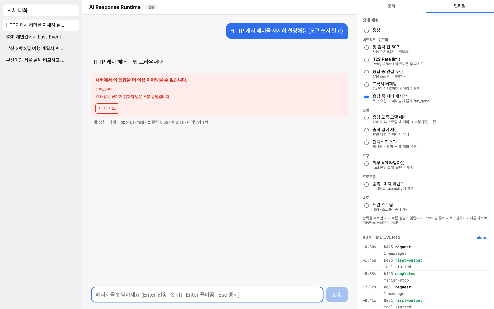

# 잘 될 때가 아니라 깨질 때를 설계하기

---

스트리밍 채팅 런타임을 직접 만들었어요. OpenAI Responses API를 SSE로 받아서 React로 그리는 건데, "잘 될 때"는 금방 됐어요. 이 글은 **"깨질 때"** 얘기예요.

이거 만들면서 시간을 제일 많이 쓴 데가 여기예요. 정상 경로는 하루면 돼요. 토큰 받아서 이어 붙이면 끝. 근데 "토큰 받다가 와이파이 끊기면", "중지 눌렀는데 서버가 계속 생성하면", "도구 하나가 타임아웃 나면", "모델이 답하다 말고 에러 내면"을 하나씩 따라가다 보면, 정상 경로보다 훨씬 많은 결정이 필요하다는 걸 알게 돼요. 그리고 그 결정들이 대부분 **제품 결정**이에요. 이미 읽은 내용을 지우고 다시 생성할 거냐, 사용자한테 뭘 보여줄 거냐, 다음 질문에 이 실패를 알릴 거냐.

---

## 먼저, 용어 몇 개

아래 내용을 따라오려면 이 런타임이 응답을 어떻게 다루는지 세 가지만 알면 돼요.

**run.** 생성 요청 한 번이에요. 클라이언트가 `runId`를 만들어서 요청에 실어 보내요. 서버가 아니라 클라이언트가 만드는 이유는, 첫 응답이 오기도 전에 취소해야 할 때 가리킬 이름이 필요해서예요.

**seq.** 서버가 run 안에서 이벤트마다 1부터 붙이는 순번이에요. 클라이언트 리듀서는 `seq === lastSeq + 1`인 이벤트만 받아들여요. 중복이면 버리고, 구멍이 나면 그 자리부터 다시 받아요.

**run 로그.** run은 HTTP 연결이랑 수명이 달라요. 서버 메모리에서 혼자 돌면서 모든 이벤트를 seq랑 같이 로그에 쌓고, 연결은 그 로그를 구독하는 창일 뿐이에요. 연결이 끊기면 `GET /runs/:id/events?after=<lastSeq>`로 다시 붙어서 그 뒤부터 받아요. 이걸 **이어받기(resume)**라고 부를게요.

이 셋이 왜 필요한지는 아래에서 장애를 하나씩 보면 저절로 나와요.

---

## 실패를 분류하기

처음엔 `try/catch` 하나에 "에러 나면 에러 메시지"였어요. 이게 왜 부족하냐면, 실패를 쭉 모아보면 바로 보여요.

| 실패 | 어디서 | 다시 하면 |
|---|---|---|
| 네트워크 연결 실패 | 연결 전 | 될 수도 |
| 503 과부하 | 첫 출력 전 | 잠시 후 될 수도 |
| 429 한도 초과 | 첫 출력 전 | 서버가 알려준 시간 뒤에 |
| 400 컨텍스트 초과 | 첫 출력 전 | **똑같이 실패** |
| 응답 도중 연결 끊김 | 출력 중 | 처음부터 다시 하면 내용이 바뀜 |
| 응답 도중 모델 에러 | 출력 중 | 처음부터 다시 하면 내용이 바뀜 |
| 도구 하나 타임아웃 | 출력 중 | 그 도구만 다시 |
| 출력 길이 제한 | 끝 | 실패가 아님. "이어서"가 필요 |
| 사용자 중지 | 아무 때나 | 실패가 아님 |

축이 세 개 보여요. **어디서**(연결 전 / 첫 출력 전 / 출력 중 / 끝), **다시 해도 되나**(됨 / 기다리면 됨 / 절대 안 됨), 그리고 **애초에 실패인가**(길이 제한이랑 중지는 실패가 아닌데 같은 코드 경로로 들어오기 쉬움).

이 세 축을 프로토콜에 그대로 실었어요. `run.failed`에는 `code`(뭐가), `retryable`(다시 해도 되나), `retryAfterMs`(언제)가 있고, `run.completed`엔 `finish`(stop / length / content_filter)가 있고, `run.cancelled`는 아예 따로예요. 서버가 분류하고 클라이언트는 믿어요. HTTP 상태 코드랑 OpenAI 에러 코드 해석하는 지식은 BFF 한 곳(`server/openai.ts`)에만 있어요.

```ts
// server/openai.ts
if (res.status === 429) {
  if (err.code === 'insufficient_quota') return { code: 'quota_exceeded', retryable: false, … }  // 기다려도 안 풀림
  return { code: 'rate_limited', retryable: true, retryAfterMs }                               // 기다리면 풀림
}
if (res.status === 400 && err.code === 'context_length_exceeded') return { code: 'context_length_exceeded', retryable: false, … }
```

429를 둘로 나눈 것처럼 같은 HTTP 상태라도 "다시 해도 되나"가 다르면 다른 코드예요. 반대로 503이랑 529(Anthropic overloaded)는 다른 상태인데 같은 `overloaded`고요. 분류 기준이 상태 코드가 아니라 **클라이언트가 뭘 할 건가**예요.

---

## 복구는 세 갈래

분류가 되면 정책은 셋으로 정리돼요. 런타임 `drive()` 안에 번호로 적어뒀어요.

```ts
// src/runtime/ChatRuntime.ts (요약)
catch (err) {
  // ① 첫 출력 전 실패 → 같은 runId로 다시 시작
  if (restart && attempt <= maxRetries) { … await sleep(delay); continue }
  // ② 출력이 시작된 뒤 끊김 → 마지막 seq부터 이어받기
  if (connected && te.retryable && te.code !== 'run_gone' && resumes < maxResumes) { … continue }
  // ③ 복구 불가 → 받은 것은 남기고 에러로 확정
  this.interrupt(threadId, runId, …)
}
```

### ① 재시작 — 아직 아무것도 못 봤을 때

503이나 네트워크 오류로 첫 출력 전에 실패하면 조용히 다시 시작해요. 사용자한텐 "연결 중"이 조금 길어진 걸로만 보여요.

대기 시간은 지수 백오프에 jitter를 더해요. 서버가 잠깐 죽었다 살아날 때 지수 백오프만 쓰면 그 순간 실패한 클라이언트가 전부 **같은 시각에** 재시도해요. 서버는 다시 쓰러지고요. `Math.random()` 곱해서 흩뿌리는 한 줄이 이걸 막아요. 429면 `Retry-After`보다 일찍 안 해요.

그리고 **같은 runId로** 다시 보내요. 503 받았다고 첫 요청이 OpenAI에 안 갔다는 보장이 없어요. 게이트웨이가 응답만 잃었을 수도 있죠. 서버는 같은 runId의 run이 있으면 새로 안 만들고 기존 거에 붙여줘요. 재시도가 이중 과금이 안 되는 이유.

### ② 이어받기 — 이미 읽기 시작했을 때

출력이 시작된 뒤에 끊기면 **절대 처음부터 다시 안 해요.** 세 문단 읽고 있는데 뒤에서 조용히 다시 생성해서 내용이 바뀌면 사용자는 자기 눈을 의심해요. 대신 run 로그 덕분에 `after=<lastSeq>`로 이어받아요. 중복은 seq 가드가 걸러요.

이어받기가 "끊겼을 때"만 일어나는 게 아니에요. 새로고침 뒤에도, 백그라운드 탭에서 돌아왔을 때도, 네트워크 돌아왔을 때도 런타임이 "reader 없는 진행 중 run"을 찾아서 다시 붙어요. 처음 버전은 "첫 출력 후 끊기면 수동 복구"였는데, 이 하나 바꾸려고 서버 run 모델을 통째로 갈았어요.

### ③ 포기 — 다시 해도 똑같을 때

컨텍스트 초과, 인증 실패, 서버가 run을 잃어버린 경우(`run_gone`)는 재시도 안 해요. 근데 포기할 때도 **받은 건 남겨요.** 부분 응답 지우고 에러 메시지로 덮는 구현이 흔한데, 사용자가 읽던 세 문단은 사용자 거예요. "위 내용은 끊기기 전까지 받은 부분 응답입니다" 하고 알리고, 에러 코드 따라 다음 행동을 다르게 제안해요. 컨텍스트 초과면 "다시 시도"가 아니라 "새 대화 시작".

### 그리고 run 안의 실패

위 셋은 "run이 실패했을 때"예요. 근데 run은 성공했는데 그 안의 **tool 하나**가 실패할 수 있어요. 외부 API 타임아웃, 모델이 없는 도시 이름 넘김.

이건 run 실패로 안 봐요. `tool.failed { callId }`로 그 tool에만 기록하고, 실패 내용을 `function_call_output`으로 모델한테 돌려줘요. 모델은 다시 시도하거나 "날씨를 가져오지 못했지만…" 하면서 답을 이어가요. 화면에선 그 카드만 빨간 느낌표고 나머지 답은 멀쩡해요. 예전 프로젝트는 tool 상태를 추정했기 때문에 실패한 tool에도 성공 체크가 떴어요. 그래서 이번엔 tool part가 `output-error`라는 자기 상태를 가져요.

---

## 장애 11개 재현하기

정책을 세웠으면 진짜 되는지 봐야죠. 근데 "와이파이 끊기는 상황"을 매번 손으로 만들 순 없어요. 그래서 BFF에 **장애 주입**을 넣었어요. 요청에 `fault: 'drop-mid-stream'`을 실으면 서버가 12번째 토큰에서 소켓을 끊고, `'rate-limit'`이면 429랑 `Retry-After`를 돌려줘요. 화면 오른쪽 패널에서 라디오로 골라요.

처음엔 네트워크 장애 4개로 시작했어요. 근데 조사(맨 아래)하면서 "실제로 운영에서 나는 장애가 네트워크뿐인가?" 하고 다시 봤는데, 아니었어요. 모델, 도구, 프로토콜 계층에도 각자 장애가 있었어요. 11개로 늘리고 계층별로 묶었어요.

| 계층 | 장애 | 서버가 하는 일 | 기대하는 복구 | 확인 |
|---|---|---|---|---|
| 네트워크 | 첫 출력 전 503 | HTTP 503 | ① 재시작, 백오프 | `retry → attempt 2` |
| 네트워크 | 429 | HTTP 429 + `Retry-After: 3` | ① 3초 카운트다운 후 재시작 | 카운트다운 UI |
| 네트워크 | 응답 중 연결 끊김 | 12번째 토큰 후 `res.destroy()`, run은 계속 | ② watchdog → 이어받기 | "이어받기 1회", 중복 없음 |
| 네트워크 | 프록시 버퍼링 | 이벤트를 2.5초마다 몰아서 | 복구 아님. 배칭으로 흡수, watchdog 오탐 없음 | 에러 없이 완료 |
| 네트워크 | 응답 중 서버 재시작 | 소켓 끊고 run 로그 삭제 | ② 시도 → `run_gone` → ③ 포기, 부분 보존 | `resume` 뒤 `interrupted run_gone` |
| 모델 | 응답 도중 모델 에러 | 15번째 토큰 후 스트림 안에서 `run.failed` | 이미 출력 있으니 재시작 안 함 → ③ | `failed` 뒤 retry 없음 |
| 모델 | 출력 길이 제한 | `run.completed { finish: 'length' }` | 실패 아님. "이어서 작성" 제안 | 노란 안내 |
| 모델 | 컨텍스트 초과 | HTTP 400 `retryable: false` | ③ 즉시. "새 대화 시작" | 요청 1회뿐 |
| 도구 | 외부 API 타임아웃 | tool 실행에서 1.5초 후 throw | tool만 실패, run은 완료 | `tool.failed` 뒤 `run.completed` |
| 프로토콜 | 중복·미지 이벤트 | 7번째마다 중복 + 모르는 타입 삽입 | 무시 + telemetry | `ignored duplicate seq`, 텍스트 깨끗 |
| 속도 | 느린 스트림 | 토큰마다 100ms 지연 | 중지 → 서버 `cancel (user)`, 스크롤 따라가기 | 서버 로그 |

"응답 중 연결 끊김"을 켜고 긴 답을 받으면 이렇게 끝나요. 12번째 토큰에서 끊겼는데 텍스트에 이음새가 없고, 아래 메트릭에 "이어받기 1회"가 찍혀요.



429는 서버가 알려준 시간만큼 기다리는 게 화면에 보여요.





패널 항목을 누르면 "언제 생기나 / 처리 안 하면 / 어떤 경로로 풀어가나 / 뭘 확인하나 / 관련 코드"가 팝업으로 떠요. 글로 설명하는 것보다 켜보는 게 빨라서요.



두 개가 특히 재밌었어요.

**"응답 중 서버 재시작"**은 이어받기 설계의 한계를 보여주는 케이스예요. run 로그가 서버 메모리에 있으니까 프로세스 죽으면 사라져요. 이때 클라이언트가 이어받기를 영원히 재시도하면 안 돼요. 서버가 404 `run_gone`을 `retryable: false`로 주고, 런타임은 ③으로 빠져요. 받은 부분은 남고 "서버에서 이 응답을 더 이상 이어받을 수 없습니다"가 떠요. 근본 해결은 로그를 Redis Streams 같은 데로 옮기는 건데, 그건 이 프로젝트 범위 밖이라 "여기까지가 한계"를 분명히 하는 쪽을 골랐어요.



**"프록시 버퍼링"**은 복구가 아니라 **오탐 방지**를 보는 케이스예요. 이벤트가 2.5초마다 덩어리로 오면 그 사이에 heartbeat도 갇혀요. watchdog 임계값이 2.5초보다 짧으면 멀쩡한 연결을 끊겼다고 판단해서 쓸데없이 이어받기를 해요. heartbeat 간격(2초), 버퍼링 주기, watchdog 임계값(7초)이 서로 짝이 맞아야 하고, 이 셋의 관계를 설명 없이 숫자로만 두면 나중에 누가 하나 바꾸다 깨뜨려요.

---

## 직접 겪은 버그들

장애 재현 장치를 만들고 나니까 장치가 버그를 찾아줬어요. 여기 건 전부 이번에 **직접** 겪은 거예요.

### heartbeat를 보내고 있었는데 화면이 멈췄다

이 글의 출발점이에요. "응답 중 연결 끊김"을 처음 재현했을 때, 서버 로그엔 분명히 소켓 끊었다고 찍혔는데 **브라우저는 영원히 "streaming"에 멈춰** 있었어요. 개발 서버 프록시가 업스트림 끊김을 브라우저에 전달하지 않았던 거예요.

"개발 서버 문제네"로 넘길 수도 있었는데, 프로덕션의 nginx, 로드밸런서, CDN도 같은 짓을 할 수 있어요. 더 중요한 깨달음은 heartbeat에 관한 거였어요. 서버는 성실하게 `: ping`을 보내고 있었어요. 근데 **클라이언트가 세고 있지 않았어요.** heartbeat는 "연결을 살려두는 것"이랑 "연결이 죽었음을 알아채는 것" 두 역할이 있고, 후자는 받는 쪽이 "마지막 박동이 언제였지?"를 묻고 있어야 성립해요.

그래서 SSE 파서에 idle watchdog을 넣었어요. 일정 시간 바이트가 하나도 안 오면 끊긴 걸로. heartbeat 주석도 바이트니까 타이머가 리셋돼요. 파서는 주석을 버리지만 watchdog은 봐요.

```ts
// src/lib/sse/parseSSE.ts
// 네트워크를 기다리는 동안에만 타이머를 건다 (소비자가 느린 것과 네트워크가 조용한 것은 다르다)
idleTimer = setTimeout(() => { timedOut = true; reader.cancel() }, idleTimeoutMs)
const { value, done } = await reader.read()
clearTimeout(idleTimer)
if (timedOut) throw new SSEIdleTimeoutError(idleTimeoutMs)
```

처음 버전에선 watchdog이 에러를 띄웠어요. 지금은 이어받기를 시작해요.

### 중지 한 번에 대화가 벽돌이 된다

tool 실행 중에 중지하면 이력에 `function_call`은 있는데 `function_call_output`이 없는 상태가 남아요. 이걸 그대로 다음 요청에 보내면? 직접 보내봤어요.

```
400 invalid_request_error: No tool output found for function call call_a.
```

그 대화는 이후 **모든** 메시지가 실패해요. AI SDK 이슈 #18425에 같은 문제가 "대화가 영구히 망가진다(permanently bricking)"는 제목으로 올라와 있고, LibreChat에도 비슷한 게(#11460) 있어요. 중지 버튼 하나가 대화를 망가뜨리는 거예요.

다음 요청 보내기 전에 이력을 정리해요.

```ts
// server/openai.ts — toResponsesInput()
// 1. 인자도 다 못 받은 tool(input-streaming)은 호출 자체를 없던 일로
if (part.state === 'input-streaming' || part.args === undefined) continue
// 2. 인자는 받았지만 결과가 없는 tool은 "사용자가 취소함" 결과를 합성
const output = part.state === 'output-available' ? part.output
  : part.state === 'output-error' ? { error: part.error }
  : { error: 'cancelled_by_user', note: '사용자가 이 작업을 중지했습니다.' }
```

지우는 것보다 **합성하는 쪽**을 골랐어요. 모델이 "사용자가 멈췄다"는 맥락을 알면 다음 답("방금은 왜 멈췄어?")이 자연스러워요. 도쿄·뉴욕·파리 날씨 3개 실행 중에 Esc 누르고 바로 "도쿄만 다시 알려줘" 보내서 정상 응답 오는 걸로 확인했어요.

### 테스트가 잡은 순서 버그

성능 때문에 "한 프레임에 쌓인 연속 delta를 하나로 합치기(coalesce)"를 넣었어요. 토큰 30개가 한 배치면 문자열 이어붙이기를 한 번만 하려고요. 이걸 넣고 테스트 돌리니까 이어받기 테스트가 깨졌어요.

재연결하면 서버가 겹치는 구간을 다시 보내요. `[seq 2(중복), seq 3(신규)]`가 한 배치로 들어와요. 합치기를 먼저 하면 이 둘이 "seq 2~3" 하나가 되고, 리듀서는 "seq 2는 이미 봤음"이라고 **통째로** 버려요. 새 토큰까지 사라져요.

순서를 바꿨어요. 연속 구간만 먼저 남기고(`contiguous`), 그다음 합쳐요. 최적화는 정확성 경계 안쪽에서만. 그리고 "하나씩 적용 = 합쳐서 적용"을 테스트로 박았어요.

### 중지했는데 방금 받은 글자가 사라진다

`stop()` 셀프 리뷰하다 발견했어요. 큐를 비우는 `killRun()`을 큐를 반영하는 `flush()`보다 먼저 부르고 있었어요. 받았지만 아직 화면에 안 그린 토큰이 버려져요. 순서 하나예요. "사용자가 본 마지막 글자 = 저장된 마지막 글자"가 깨지는 버그.

### 취소된 tool이 계속 "조회 중"

날씨 3개 실행 중 중지했더니 카드 3개가 계속 스피너를 돌렸어요. 리듀서는 run 끝날 때 미완료 tool을 `cancelled`로 확정하는데, 날씨 카드 컴포넌트가 "에러" 아니면 "결과 있음"만 분기하고 나머진 전부 로딩으로 그렸어요. 예전의 "실패해도 성공 체크"랑 같은 계열이에요. **View는 모든 상태를 처리해야 해요.** 상태가 5개면 5개 전부.

### Node만 해외 API에 연결을 못 했다

날씨 tool이 `fetch failed`로 죽었는데 같은 URL을 curl로 치면 1.3초 만에 돼요. 원인은 Node의 Happy Eyeballs였어요. IPv6랑 IPv4를 번갈아 시도하는데 **주소당 250ms**만 기다려요. RTT 400ms인 해외 서버는 IPv4도 시간 안에 연결이 안 되고, IPv6가 막힌 환경이면 둘 다 실패해서 285ms 만에 `ETIMEDOUT`. `net.setDefaultAutoSelectFamilyAttemptTimeout(2000)`으로 해결했고, 덤으로 tool마다 8초 타임아웃을 걸어서 외부 API 하나가 run 전체를 붙잡지 못하게 했어요.

프론트 버그는 아니에요. 근데 "도구 실패"를 설계하면서 **진짜로 실패하는 도구**를 안 만났으면 tool별 타임아웃이 필요하다는 걸 체감 못 했을 거예요.

### 한국어에서만 생기는 취소선

"부산은 17.1~23.1도, 서울은 11.2~21.3도"에서 가운데가 취소선으로 그어졌어요. GFM Markdown은 물결표 **한 쌍**(`~a~`)도 취소선으로 봐요. 한국어는 범위를 `~` 하나로 쓰죠. 범위가 한 문장에 두 번 나오면 그 사이가 취소선이 돼요. `remarkGfm({ singleTilde: false })` 한 줄인데, 영어로만 테스트하면 절대 못 잡아요. 에러 처리 글에 넣은 이유는, "에러"가 예외만이 아니라 **잘못 그려진 화면**도 포함한다는 걸 말하고 싶어서예요.

---

## 다른 사람들은 뭘 겪었나

이거 만들면서 Vercel AI SDK, assistant-ui, streamdown, LibreChat, CopilotKit, Open WebUI 이슈 트래커를 한참 읽었어요. "내가 상상한 장애"가 아니라 "실제로 보고된 장애"로 설계를 검증하고 싶어서요. 반영한 것만 추리면:

| 보고된 문제 | 출처 | 여기선 |
|---|---|---|
| `stop()`이 서버 생성을 못 멈춤 → 과금 누수 | vercel/ai #10719, Ably "stop vs disconnect" | 명시적 cancel. 끊김과 중지 분리 |
| 중지 한 번에 대화가 영구히 망가짐 | vercel/ai #18425, LibreChat #11460 | 이력 정리 (위) |
| 탭 전환·모바일 백그라운드 후 스트림이 죽은 채 남음 | vercel/ai #11865 (open) | `visibilitychange`/`online`/`pageshow`에서 이어받기 |
| 대화 전환 시 스트림이 새 대화에 쓰임 | vercel/ai #696, #5015, assistant-ui #7037 | 스레드별 격리, reader를 React 바깥에 |
| 모르는 이벤트 타입에 클라이언트가 멈춤 | CopilotKit #3323 | `isKnownEvent`로 무시 + telemetry |
| 오버로드 에러가 HTTP 200 뒤 스트림 안에서 옴 | Anthropic 문서, 529 사례 | `run.failed`를 스트림 내 이벤트로 |
| 이어받기와 중지가 충돌 | AI SDK 문서 "abort breaks resumable streams" | 중지는 cancel 요청, 끊김은 아무것도 안 함 |
| Safari에서 IME 확정 Enter가 전송, Esc가 응답을 중지 | assistant-ui #8199 | 3중 IME 가드 + Esc에도 |
| 스트리밍 텍스트가 스크린리더에서 토큰마다 읽히거나 누락 | azukiazusa 블로그 | 목록은 `aria-live="off"`, 상태 전이만 따로 |

제일 크게 배운 건, **라이브러리가 대신 정해준 결정이 내 상황이랑 안 맞을 때가 제일 고치기 어렵다**는 거예요. AI SDK의 "연결 끊기면 abort"는 합리적인 기본값이에요. 근데 이어받기를 원하는 순간 정반대가 돼요. 라이브러리를 쓰더라도 그게 뭘 대신 결정해주고 있는지는 알고 써야겠더라고요.

---

솔직하게 적어둘 것도 있어요. 서버 재시작 케이스에서 보듯 run 로그가 메모리에만 있어서 인스턴스가 여러 개면 안 돼요. 모바일 백그라운드랑 Safari IME는 이슈 보고를 근거로 구현했지 실기기에서 확인은 못 했어요. 멀티 탭에서 같은 대화에 동시에 보내는 것도 아직 안 막았어요. 한계는 안다는 뜻으로 README 로드맵에 적어뒀어요.

에러 처리를 설계하면서 제일 자주 돌아온 질문은 "이때 사용자는 뭘 보고 있지?"였어요. 기술 질문처럼 보이는데 결국 제품 질문이었고, 그 답을 코드로 옮기는 과정이 이 프로젝트에서 제일 많이 배운 부분이에요.

---

### 부록: 장애와 테스트

| 장애 / 시나리오 | 테스트 |
|---|---|
| 응답 중 끊김 → 이어받기 | `resumes from the last seq after a mid-stream disconnect` |
| 완료 이벤트 없는 종료 → 이어받기 | `treats a stream that ends without a terminal event as a disconnect` |
| 첫 출력 전 429 → Retry-After 존중 | `retries the start … honoring retryAfterMs` |
| 서버가 보낸 재시도 가능 실패(출력 전) | `silently retries a retryable server failure` |
| 컨텍스트 초과 → 재시도 안 함 | `does not auto-retry a non-retryable error` |
| 서버 재시작 → run_gone → 포기, 부분 보존 | `stops resuming when the server lost the run` |
| 중복·미지 이벤트 무시 | `ignores duplicated and unknown events` |
| 중지 → 서버 cancel, 부분 보존 | `stop() cancels on the server, keeps already-received text` |
| 대화 전환 중에도 원래 대화로 | `keeps streaming into the original thread` |
| 새로고침 후 이어받기 | `resumes a persisted in-flight run after a reload` |
| 짝 없는 tool 호출 정리 | `server/openai.test.ts` |
| 프록시가 끊김을 삼킴 (watchdog) | `parseSSE.test.ts: throws when the stream goes silent` |
| heartbeat만 오는 긴 침묵 | `parseSSE.test.ts: heartbeat comments keep the stream alive` |
