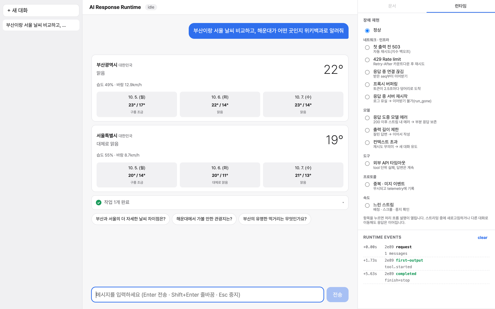
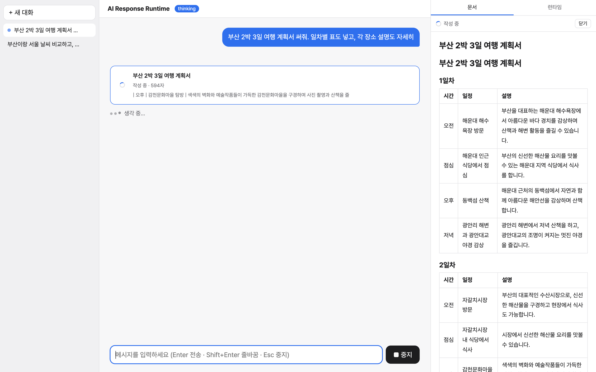

# AI 응답을 컴포넌트로 바꾸기

> tool 호출이 섞여 있는 LLM 응답을 어떻게 화면으로 그리나. 예전에 만들었던 방식이 왜 깨졌고, 다시 만들면서 뭘 바꿨는지.
> 코드는 `src/runtime/types.ts`, `src/tools/*`, `src/components/ToolParts.tsx`, `layoutParts.ts`.

---

AI 채팅에서 "응답을 그린다"가 텍스트만 그리는 거면 쉬워요. 마크다운 하나 붙이면 끝이죠. 근데 요즘 응답은 텍스트가 아니에요. 모델이 중간에 검색을 하고, 날씨를 조회하고, 문서를 쓰고, 그 결과를 섞어서 답해요. 응답 하나가 이렇게 생겼어요.

```
"찾아볼게요"
  → [검색 호출: 해운대]
  → [날씨 호출: 부산]  [날씨 호출: 서울]   ← 병렬
  → [검색 결과]
  → [날씨 결과: 서울]  [날씨 결과: 부산]   ← 역순으로 도착
"부산은 맑고 20도예요. 해운대는…"
  → [후속 질문 제안]
```

이걸 화면으로 바꾸는 게 이 글 주제예요. 예전에 한 번 만들어봤고, 그때 뭐가 안 됐는지부터 얘기할게요.

---

## 예전엔 어떻게 했나

에이전트 서버가 이벤트를 보내면 프론트에서 이벤트 하나당 말풍선 하나를 붙였어요. tool 호출 이벤트면 "검색 중…" 행, tool 결과 이벤트면 결과 행. 그리고 tool 이름을 보고 어떤 컴포넌트로 그릴지 정했어요.

```ts
// 단순화
if (isIgnoreTool(name)) return null
if (isSearchTool(name)) return <SearchTool … />
if (isFileWriteTool(name) || isArtifactTool(name)) return <FileCard … />
if (name === 'get_workflow_status') return <Workflow … />
if (name === 'filesystem_read_file') return <Status label={`Reading ${path}`} />
// ... 열 개쯤 더
return <Status label={humanize(name)} />
```

이름 배열이 네 개(IGNORE, SEARCH, FILE_WRITE, ARTIFACT)에 if 체인이 이어졌어요. tool 추가하면 배열이랑 if를 둘 다 고쳐야 했고, 어느 tool이 어디 들어가는지 한눈에 안 보였어요. 그래도 이건 그냥 지저분한 거예요. 진짜 문제는 **상태**였어요.

### 상태를 추정했다

"이 tool이 지금 실행 중인가?"를 어떻게 알았냐면, **그 행이 그룹의 마지막 메시지인가**로 판단했어요. 메시지마다 `isNew` 플래그가 있고, 새 메시지가 오면 기존 것들은 전부 false가 돼요. 마지막 행이면 스피너, 아니면 완료.

이게 왜 깨지냐면:

- 병렬 호출 3개가 한 이벤트로 오면 메시지 3개가 붙는데, `isNew`는 마지막 하나만 true예요. **스피너가 하나만 돌아요.**
- tool이 실패해도 결과 행은 결과 행이에요. 실패 상태라는 게 없으니까 **빨간 느낌표 대신 초록 체크**가 떠요.
- 결과가 영영 안 오는 tool은 다음 메시지가 오는 순간 isNew가 꺼지면서 **그냥 사라져요.** 실행 중이었다는 흔적도 없이.

상태를 데이터로 받지 않고 **위치에서 추정**했기 때문이에요. 추정은 추정이 맞는 경우에만 맞아요.

### 부수효과가 mount에 있었다

파일 쓰기 tool 결과 카드는 mount될 때 워크스페이스 파일 목록을 다시 불러왔어요. 자연스러워 보이죠. 근데 히스토리를 불러오면 그 카드가 N개 mount되고, refetch가 N번 나가요. "tool이 끝났을 때 한 번"이어야 할 일이 "그 카드가 화면에 그려질 때마다"가 된 거예요.

### key가 인덱스였다

tool 행들을 묶어서 접이식 그룹으로 보여줬는데, 그룹 key가 `subgroup-${idx}`였어요. 이전 페이지를 위에 붙이면 인덱스가 밀리면서 그룹이 통째로 remount되고, 사용자가 펼쳐뒀던 게 접혀요.

---

## 다시 만들면서 정한 것

### 1. 메시지는 문자열이 아니라 parts

응답 안에서 텍스트랑 tool이 섞여서 오니까, 메시지를 "parts의 순서 있는 목록"으로 바꿨어요.

```ts
// src/runtime/types.ts
export interface TextPart { type: 'text'; id: string; text: string }

export interface ToolPart {
  type: 'tool'
  callId: string
  name: string
  argsText: string          // 스트리밍 중인 원본 인자 문자열
  args?: unknown            // 인자가 확정되면
  state: ToolState          // 아래
  output?: unknown
  error?: { code: string; message: string }
}

export type ToolState = 'input-streaming' | 'input-available' | 'output-available' | 'output-error' | 'cancelled'
```

"이벤트 하나 = 말풍선 하나"가 아니라 "메시지 하나 안에 parts가 쌓인다"예요. 텍스트는 마지막 text part에 이어 붙고, tool은 새 part로 들어가고, 그 tool의 결과는 **같은 part**를 찾아서 갱신해요.

### 2. 상태는 추정하지 않고 선언한다

서버가 tool 하나당 이벤트를 이렇게 보내요.

```
tool.started        { callId, name }
tool.args.delta     { callId, delta }      ← 여러 번
tool.input.completed{ callId, args }
tool.result         { callId, output }     또는  tool.failed { callId, code, message }
```

전부 `callId`가 붙어 있어요. 리듀서는 그 callId의 part를 찾아서 상태를 바꿔요.

```ts
// src/runtime/reducer.ts
function withToolPart(m: Message, callId: string, fn: (p: ToolPart) => ToolPart): Message {
  const idx = m.parts.findIndex((p) => p.type === 'tool' && p.callId === callId)
  if (idx === -1) return m
  const parts = m.parts.slice()
  parts[idx] = fn(parts[idx] as ToolPart)
  return { ...m, parts }
}
```

이러면 병렬 호출 3개는 각자 자기 상태를 가져요. 결과가 역순으로 와도 상관없어요. callId로 찾으니까. 실패는 `output-error`라는 자기 상태가 있어요. "마지막 행인가" 같은 걸 볼 필요가 없어요.

하나 더. run이 끝났는데(완료든 중지든 실패든) 아직 `input-streaming`이나 `input-available`에 머물러 있는 tool은 `cancelled`로 확정해요. 안 그러면 영원히 도는 스피너가 남아요.

```ts
function settleTools(parts: Part[]): Part[] {
  return parts.map((p) =>
    p.type === 'tool' && (p.state === 'input-streaming' || p.state === 'input-available')
      ? { ...p, state: 'cancelled' }
      : p,
  )
}
```

서버 쪽은 OpenAI Responses API 이벤트를 저 다섯 개로 번역해요. `response.output_item.added`(type이 function_call)가 `tool.started`, `response.function_call_arguments.delta`가 `tool.args.delta`, 이런 식. 병렬 호출은 OpenAI가 `item_id`로 구분해 주니까 그걸 callId에 매핑하면 돼요.

### 3. tool 하나 = 레지스트리 항목 하나

if 체인이랑 이름 배열 대신, tool마다 "어떻게 그릴지"를 한 곳에 선언해요.

```ts
// src/tools/views.tsx
export const toolRegistry: Record<string, ToolUI> = {
  search_wikipedia: defineTool<SearchArgs, SearchOutput>({
    placement: 'step',
    icon: '🔎',
    label: (a, p) => isRunning(p) ? `위키백과 검색 중 · ${a?.query ?? ''}` : `위키백과 검색 · ${a?.query ?? ''}`,
    View: SearchResults,
    isOutput: isSearchOutput,
  }),
  get_weather: defineTool<WeatherArgs, WeatherOutput>({
    placement: 'pinned',
    icon: '🌤',
    label: (a) => `날씨 · ${a?.city ?? ''}`,
    View: WeatherCard,
    isOutput: isWeatherOutput,
  }),
  create_document: defineTool<DocArgs, DocOutput>({
    placement: 'pinned',
    streamArgs: true,   // 인자(문서 본문) 자체가 콘텐츠 → 부분 파싱해서 실시간으로
    label: (a) => `문서 · ${a?.title ?? ''}`,
    View: DocumentCard,
  }),
  suggest_followups: defineTool<FollowupArgs, unknown>({
    placement: 'footer',
    streamArgs: true,
    View: FollowupChips,
  }),
  get_current_time: defineTool({ placement: 'hidden', label: () => '현재 시각 확인' }),
}
```

새 tool 추가하면 여기 한 줄이에요. 렌더링 코드는 안 건드려요. 모르는 tool이 오면 fallback(이름을 사람이 읽을 수 있게 바꾼 한 줄)으로 그려요.

`placement`가 핵심이에요. 모든 tool을 똑같이 그리면 안 되더라고요.

| placement | 뜻 | 예 |
|---|---|---|
| `step` | "작업 N개" 접이식 묶음 안의 한 줄. 과정에 가까운 것 | 검색 |
| `pinned` | 본문 흐름 안에 카드로 고정. 결과물 자체인 것 | 날씨, 문서 |
| `footer` | 응답 끝난 뒤 맨 아래 | 후속 질문 칩 |
| `hidden` | 안 그림 | 현재 시각 조회 |

예전 프로젝트에서 "접이식 안에 파일 카드가 숨어서 못 찾겠다"는 피드백이 있었어요. 그래서 파일 카드만 접이식 밖으로 빼는 특수 처리가 있었는데, 이걸 일반화한 게 `placement`예요.

### 4. parts → 화면 구조

parts를 그대로 map 돌리면 안 돼요. 연속된 step tool은 하나로 묶어야 하고, footer는 맨 아래로 보내야 하고, hidden은 빼야 해요. 이걸 순수 함수 하나로 뺐어요.

```ts
// src/components/layoutParts.ts
export function layoutParts(parts: Part[], resolve: (name: string) => ToolUI): { segments: Segment[]; footer: ToolPart[] }
```

입력이 parts고 출력이 `[텍스트 | 작업 묶음 | 고정 카드]` 배열이랑 footer 배열. 순수 함수라 테스트가 쉬워요. "연속된 step은 하나로 묶인다", "묶음의 key는 첫 part의 callId라서 뒤에 추가돼도 remount 안 된다" 같은 걸 바로 검증해요. 그 index key 문제가 여기서 해결됐어요.

렌더 쪽은 이 결과를 그대로 그려요.

```tsx
{segments.map((s) =>
  s.kind === 'text'  ? <StreamingMarkdown key={s.key} … />
  : s.kind === 'steps' ? <ToolSteps key={s.key} parts={s.parts} … />
  : <ToolSlot key={s.key} part={s.part} … />
)}
```

작업 묶음은 실행 중이면 자동으로 펼쳐지고 끝나면 접혀요. 근데 사용자가 한 번이라도 직접 열고 닫으면 그 선택을 존중해요(`userOpen ?? running > 0`). 자동이 사용자 손을 이기면 짜증 나니까.



### 5. 인자도 스트리밍한다

`create_document` tool은 인자가 `{ title, content }`인데 content가 문서 본문 전체예요. 모델이 이걸 토큰 단위로 흘려보내요. 다 받을 때까지 스피너만 돌리면 사용자는 30초 동안 아무것도 못 봐요.

그래서 인자 문자열(`argsText`)을 받는 족족 **부분 JSON으로 파싱**해서 보여줘요. 지금까지 받은 게 `{"title":"부산 여행","content":"# 1일차\n해운대에서`라면, 닫는 따옴표랑 괄호를 보충해서 `{ title: "부산 여행", content: "# 1일차\n해운대에서" }`를 꺼내요.

```ts
// src/lib/partialJson.ts
export function parsePartialJson<T>(input: string): T | undefined
```

문자열을 한 번 훑으면서 열린 괄호·문자열을 스택으로 추적하고, 끝에서 닫는 토큰을 보충해요. 키만 있고 값이 없는 꼬리(`"body":`), 쉼표로 끝나는 꼬리, 이스케이프 중간(`\`)은 잘라내요. 숫자나 `true` 같은 리터럴은 끝나기 전엔 안 내보내요. `12`가 `123`이 될 수 있으니까. "모든 접두에 대해 예외 없이, 결과는 완성본의 접두"를 테스트로 박았어요.

이걸 모든 tool에 하진 않아요. 레지스트리에서 `streamArgs: true`인 것만. 날씨는 인자가 `{ city }`라 스트리밍할 게 없고, 매 delta마다 모든 tool 인자를 다시 파싱하면 그 자체가 O(n²)이에요. 파싱은 **화면이 필요로 할 때만** 해요.

```ts
// src/tools/registry.ts
export function useToolArgs<A>(part: ToolPart, ui: ToolUI<A>): Partial<A> | undefined {
  return useMemo(() => {
    if (part.args !== undefined) return part.args as Partial<A>
    if (!ui.streamArgs || !part.argsText) return undefined
    return parsePartialJson<Partial<A>>(part.argsText)
  }, [part.args, part.argsText, ui.streamArgs])
}
```

문서는 오른쪽 패널에서 실시간으로 써져요. 패널은 그 tool part 하나만 구독해서, 같은 대화의 다른 메시지가 바뀌어도 리렌더 안 돼요.



### 6. 부수효과는 이벤트 시점에

"문서 작성 tool이 시작되면 패널을 연다"를 어디서 할까. 예전처럼 카드가 mount될 때 하면 히스토리 불러올 때마다 열려요. 그래서 런타임이 `tool.started` 이벤트를 받는 **그 시점**에 콜백을 쏴요.

```ts
new ChatRuntime({
  onToolStarted: (info) => {
    if (info.name === 'create_document') openPanel(info)
  },
})
```

mount는 "화면에 그려졌다"지 "일이 일어났다"가 아니에요. 일이 일어난 시점은 이벤트가 들어온 시점이에요.

---

## 그래도 깨진 것 하나

이렇게 해놓고도 버그가 하나 나왔어요. 날씨 3개 실행 중에 중지했더니 카드 3개가 계속 "조회 중…" 스피너를 돌렸어요.

리듀서는 제대로 `cancelled`로 바꿨어요. 근데 `WeatherCard`가 이렇게 생겼었어요.

```tsx
if (part.state === 'output-error') return <에러 카드 />
if (!output) return <스피너 />     // ← cancelled도 여기로
return <날씨 카드 />
```

상태가 5개인데 2개만 분기하고 나머지를 전부 "로딩"으로 퉁친 거예요. 예전의 "실패해도 성공 체크"랑 정확히 같은 종류예요. 상태를 선언으로 바꿔도, **View가 모든 상태를 처리하지 않으면** 결국 같은 버그가 나요.

이게 지금 구조의 약점이에요. 상태 5개를 처리하는 책임이 View마다 떠넘겨져 있어요. 다음에 손본다면 레지스트리가 상태별 껍데기(로딩/실패/취소)를 기본으로 주고 View는 성공 화면만 그리게 할 거예요. 그러면 빼먹을 수가 없으니까.

하나 더. 이 글 스크린샷 찍다가 발견한 건데, 모델이 가끔 tool을 호출하는 대신 본문에 `functions.suggest_followups({ questions: [...] })`라고 **텍스트로 써요.** 함수 호출 문법을 흉내 내는 거예요. 응답 → 컴포넌트 파이프라인이 아무리 깔끔해도 모델이 파이프라인에 안 태우면 소용이 없죠. 시스템 프롬프트에 "tool은 function calling으로만, 본문에 tool 문법을 쓰지 말 것"을 명시해서 줄였는데, 완전히 없앨 수 있다는 보장은 없어요. 프론트엔드가 프롬프트의 소비자이기도 하다는 걸 여기서 배웠어요.

---

예전 방식이랑 지금 방식 차이를 한 줄로 줄이면 이거예요. 예전엔 **tool 이름을 보고 분기**했고, 지금은 **tool이 자기 상태랑 배치를 들고 와요.** 렌더링 코드는 그걸 그냥 그려요. 분기가 없으니까 새 tool이 와도, 병렬로 와도, 역순으로 와도, 중간에 끊겨도 같은 코드가 돌아요.

---

### 부록: 테스트

| 시나리오 | 테스트 |
|---|---|
| 병렬 호출을 callId로 추적, 결과 역순 도착 | `reducer.test.ts: tracks each parallel call by callId, not by position` |
| 텍스트와 tool이 도착 순서대로 섞임 | `interleaves text and tools in arrival order` |
| 중지 시 실행 중 tool을 cancelled로 | `settles running tools as cancelled` |
| step 묶기 / pinned 인라인 / footer / hidden | `layoutParts.test.ts` |
| 묶음이 커져도 key 유지 | `uses stable keys so a growing group is not remounted` |
| 부분 JSON: 모든 접두에서 예외 없음 | `partialJson.test.ts: every prefix of a valid JSON yields a value consistent with the final one` |
